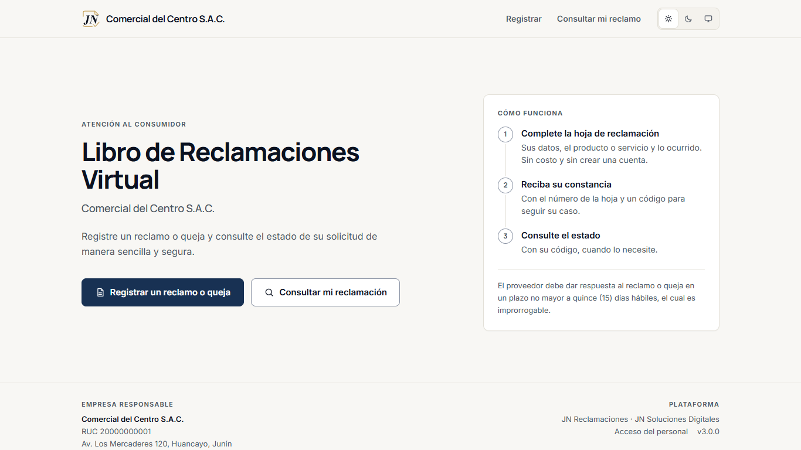
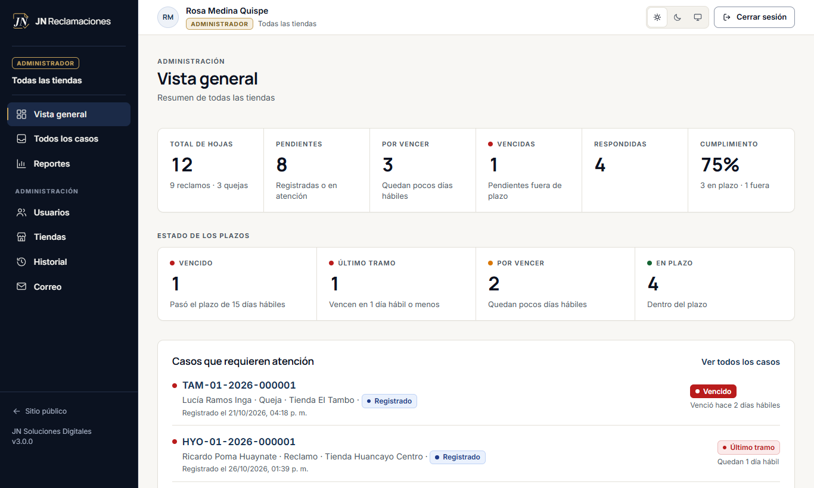
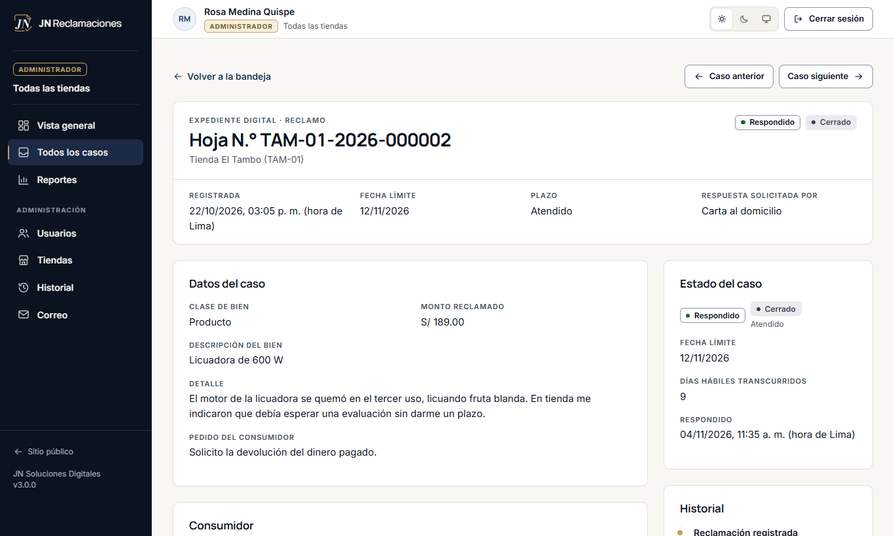
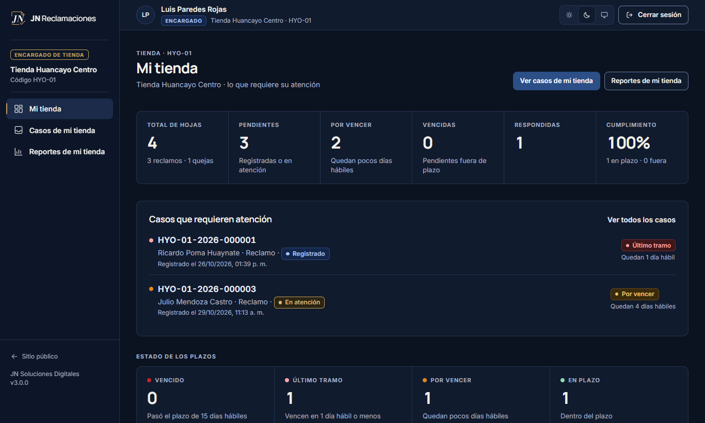
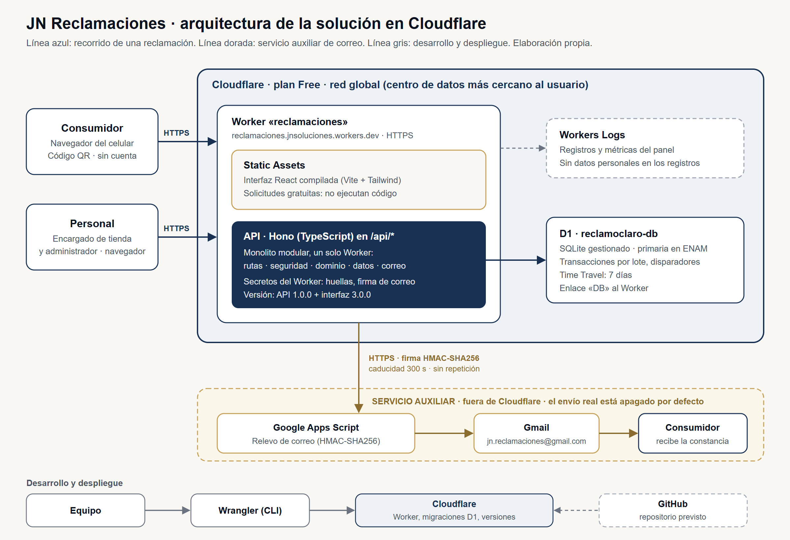

<p align="center">
  <picture>
    <source media="(prefers-color-scheme: dark)" srcset="src/web/marca/logo-horizontal-oscuro.svg">
    
  </picture>
</p>

<p align="center"><strong>Libro de Reclamaciones Virtual en la nube</strong><br>
Proyecto final · Servicios Cloud (100000SI97) · Universidad Tecnológica del Perú · 2026-2</p>

<p align="center">
  <a href="https://reclamaciones.jnsoluciones.workers.dev"><strong>reclamaciones.jnsoluciones.workers.dev</strong></a>
</p>

---

**JN Reclamaciones** es un sistema de gestión del Libro de Reclamaciones Virtual desplegado en Cloudflare. Se desarrolló para el caso de **Comercial del Centro S.A.C.**, una empresa de electrodomésticos y artículos para el hogar con cinco establecimientos en Junín.

> **Prototipo académico.** La empresa, sus tiendas, su personal y las reclamaciones de la demostración son un **caso empresarial simulado**: no corresponden a personas ni empresas reales. El portal lo indica con el aviso «Prototipo académico — entorno de demostración». No se declara cumplimiento normativo pleno; ver [Limitaciones](#limitaciones).

## Problema y solución

Cada tienda llevaba su libro por separado: sin numeración común, sin saber qué hojas estaban por vencer y sin seguimiento para el consumidor. El plazo legal de respuesta es de quince días hábiles.

JN Reclamaciones centraliza las cinco tiendas en una sola aplicación web en la nube: numera cada hoja de forma correlativa por tienda, controla el plazo con un semáforo, permite al consumidor seguir su caso y da a la empresa indicadores y reportes por establecimiento. Es **multisede** (una empresa, varias tiendas), no multiempresa.

## Funcionalidades

| Perfil | Qué puede hacer |
|---|---|
| Consumidor | Registrar un reclamo o una queja sin crear cuenta; recibir una constancia con número y código de seguimiento; consultar el estado; ver la respuesta y descargar la carta en PDF tras confirmar su número de documento |
| Encargado de tienda | Ver y atender solo los casos de su establecimiento; registrar la respuesta por correo o por carta; registrar la entrega de la carta |
| Administración | Ver todas las tiendas; indicadores y semáforo de plazos; reportes con exportación a CSV (compatible con Excel) y PDF; gestionar usuarios y establecimientos; historial de acciones; controlar el envío de correos |

Además: temas claro y oscuro, interfaz adaptable a celular, constancia imprimible y correos de constancia y respuesta con la identidad de la empresa.

## Capturas

| Portal público | Panel de la administración |
|---|---|
|  |  |
| **Expediente digital de un caso** | **Panel del encargado (tema oscuro)** |
|  |  |

Las capturas muestran datos simulados.

## Arquitectura



La aplicación es un **monolito modular en tres capas** (interfaz, API REST y datos) que se despliega como **un solo Worker**. Se ejecuta de forma **serverless** sobre la **infraestructura distribuida** de Cloudflare: lo distribuido es la plataforma, no el diseño. No son microservicios.

**Recorrido de un registro:** el navegador llega por HTTPS al centro de datos de Cloudflare más cercano → Static Assets entrega la interfaz sin ejecutar código → la interfaz llama a `POST /api/reclamos` → el Worker valida, aplica el límite por origen y calcula la fecha límite → en una sola transacción de D1 incrementa el contador de la tienda y guarda la hoja → si el consumidor dio un correo, el Worker pide la constancia al servicio auxiliar de correo con una firma HMAC-SHA256. Si el correo falla, la hoja ya está guardada.

| Servicio | Uso |
|---|---|
| Cloudflare Workers | API REST en TypeScript con Hono: validación, sesiones, permisos, plazos, reportes y correo |
| Workers Static Assets | Interfaz React compilada; solo `/api/*` ejecuta código |
| Cloudflare D1 | Base SQLite gestionada (ubicación primaria ENAM) con restricciones y disparadores que impiden borrar hojas o alterar los datos del consumidor |
| Secretos de Workers | `SECRETO_HUELLAS`, `SECRETO_CORREO`, `URL_RELEVO_CORREO` |
| Workers Logs | Registros y métricas, sin datos personales |
| Google Apps Script + Gmail | Servicio auxiliar de correo (`integraciones/apps_script/Codigo.gs`): firma HMAC, caducidad de 300 s y protección contra repetición. El envío real está apagado por defecto |

## Tecnologías

TypeScript · Hono · zod · React 19 · React Router 7 · Vite · Tailwind CSS 4 · jsPDF · Cloudflare Workers, D1 y Static Assets · Wrangler 4 · Node.js · Google Apps Script.

## Estructura

```
migrations/                 Esquema D1, datos iniciales, feriados y ampliación 1.0.0 (0001 a 0004)
src/worker/                 API: rutas, seguridad, reglas de plazos y validación, datos y correo
src/web/                    Interfaz React: páginas, componentes, carta PDF, reportes y marca
src/compartido/             Marca y logotipo compartidos por la web, los PDF y los correos
integraciones/apps_script/  Relevo de correo (Google Apps Script)
pruebas/                    P1 funcional, P2 concurrencia, P3 seguridad, P4 despliegue, P5 correo, unitarias
scripts/                    Usuarios, base de demostración, respaldo cifrado, capturas y verificación
docs/                       Contrato de la API e imágenes de este README
```

Algunos scripts de capturas y muestras escriben en carpetas de documentación del proyecto académico que no forman parte de este repositorio.

## Instalación y ejecución local

Requisitos: Node.js 20 o superior y npm.

```bash
npm ci
cp .dev.vars.example .dev.vars        # ponga valores propios; .dev.vars no se versiona
npm run db:local                      # aplica las migraciones a una base D1 local
node scripts/crear_usuarios_de_prueba.mjs   # crea cuentas locales; las claves quedan en un archivo *.local.json ignorado
npm run build
npm run dev                           # http://localhost:8787
```

`npm run tipos` comprueba TypeScript y `npm run web` abre solo la interfaz con Vite.

## Despliegue en Cloudflare

```bash
npx wrangler login                                   # autoriza Wrangler en el navegador
npx wrangler d1 create <nombre-de-su-base>           # solo la primera vez; copie el id en wrangler.jsonc
npx wrangler d1 migrations apply <nombre-de-su-base> --remote
npx wrangler secret put SECRETO_HUELLAS              # y, si usa correo, SECRETO_CORREO y URL_RELEVO_CORREO
npm run build && npx wrangler deploy                 # publica interfaz y API como una sola versión
npx wrangler rollback <id-de-version>                # vuelve a una versión anterior
```

`wrangler.jsonc` contiene el identificador de la base del despliegue académico; quien despliegue en su propia cuenta debe reemplazarlo por el de su base. Ese identificador no da acceso a la base sin las credenciales de la cuenta.

Para cambiar el nombre de un Worker ya desplegado, renómbrelo en el panel de Cloudflare: cambiar solo `name` en `wrangler.jsonc` crearía otro Worker sin historial ni secretos.

## Pruebas

```bash
npm run prueba:unidad     # plazos, correo y marca
npm run prueba:p1         # funcional
npm run prueba:p2         # concurrencia: 100 registros, 10 en paralelo
npm run prueba:p3         # seguridad
npm run prueba:p5         # correo con relevo simulado (solo local)
```

Las variantes `prueba:p1:nube`, `prueba:p2:nube` y `prueba:p3:nube` se ejecutan contra el despliegue y **crean hojas de prueba**: no deben usarse sobre una base de demostración.

Resultados obtenidos en Cloudflare (15 de noviembre de 2026, versión con la interfaz definitiva):

| Prueba | Resultado |
|---|---|
| P1 funcional | 112 de 112 verificaciones |
| P2 concurrencia | 16 de 16; 100 registros aceptados en 4,8 s; mediana 424 ms, p95 714 ms; numeración sin duplicados ni saltos |
| P3 seguridad | 99 de 99 |
| P4 retroceso | Versión anterior visible en 34 s, regreso en 9 s, sin errores en 10 consultas |
| Correo real | Constancia y respuesta recibidas (16 de noviembre de 2026) |

En local, con el código final: P1 116/116, P2 15/15, P3 99/99, P5 50/50 y 17 pruebas unitarias.

## Seguridad

- Contraseñas con PBKDF2-HMAC-SHA256 (100 000 iteraciones) y sal por usuario.
- Sesiones guardadas como huella; cookie `HttpOnly`, `Secure`, `SameSite=Lax` y prefijo `__Host-`; protección CSRF.
- Permisos por rol y por establecimiento dentro de cada consulta SQL, siempre parametrizada.
- Límites de intentos de acceso, de consulta y de registros por origen.
- Código de seguimiento aleatorio de 128 bits; la respuesta y la carta exigen el número de documento.
- Ningún secreto en el código ni en este repositorio.

## Costo

| Escenario | Costo mensual |
|---|---|
| Demostración académica (real) | S/ 0.00: plan gratuito de Cloudflare, sin tarjeta ni dominio |
| Producción (hipotético, 180 hojas y unas 30 400 solicitudes al mes) | US$ 5,00: mínimo de Workers Paid, sin excesos |

Cloudflare no publica una calculadora oficial para Workers y D1: el cálculo usa su tabla de precios y se contrastó con una calculadora de terceros. Si el consumo supera lo incluido, el costo crece según la tarifa. No incluye dominio propio ni correo transaccional.

## Limitaciones

- Funciona dentro de las cuotas del plan gratuito; al agotarlas el servicio se detiene hasta el reinicio diario.
- La entrega del correo depende de Gmail y no está garantizada en todos los casos (puede llegar a Spam).
- La carta en PDF no lleva firma digital certificada; la entrega física la registra el personal y no se verifica automáticamente.
- La exportación es CSV compatible con Excel, no un archivo `.xlsx`.
- D1 no ofrece ubicación primaria en Sudamérica; no hay acuerdo de nivel de servicio en el plan gratuito.
- La revisión normativa está pendiente: no se declara conformidad con el Reglamento del Libro de Reclamaciones ni con la Ley N.° 29733.

## Contexto académico

- **Curso:** Servicios Cloud (100000SI97), Universidad Tecnológica del Perú, 2026-2.
- **Docente:** Mg. Víctor Manuel Ascue Morales.
- **Equipo:** JN Soluciones Digitales (dos integrantes).
- **Uso de inteligencia artificial:** el desarrollo, las pruebas y la documentación se hicieron con Claude Code (Anthropic), con los modelos Claude Fable 5.2, Claude Opus 5.5 y Claude Sonnet 5.5. El equipo aprobó cada decisión y verificó el funcionamiento con las pruebas y el despliegue descritos arriba.
